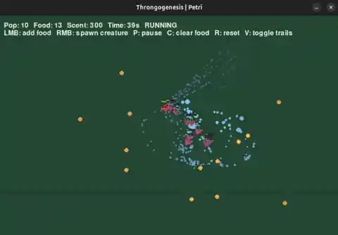
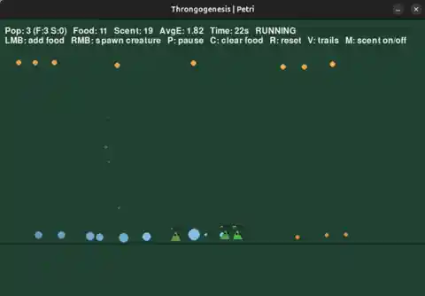
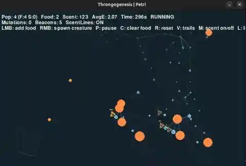
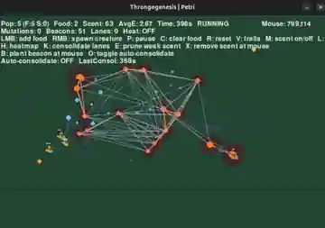

<div align="center">

# 🧫 THRONGOGENESIS

**A game that rewrites itself.**

*Start with a creature. Give an AI creative control. See what grows.*


</div>

Inspired by *Thronglets*. Every few minutes, an LLM art director looks at what happened in the game and decides what to create next. It can rewrite the mechanics, artwork, world, or even the entire genre. Or do nothing.

Nobody knows where this ends.

## Look what grew

<table>
<tr>
<td width="50%"></td>
<td width="50%"></td>
</tr>
<tr>
<td>Scent trails and new creature visuals</td>
<td>Foragers, scouts and inherited traits</td>
</tr>
<tr>
<td></td>
<td></td>
</tr>
<tr>
<td>Beacons, scout memory and scent networks</td>
<td>Hubs, lane consolidation and player-built pathways</td>
</tr>
</table>

One run with GPT-5-mini went from a little creature in a field to a pheromone network with memory, specialized creatures, genetics, and tools for sculpting its own little world.

The art director even suggested an experiment in its journal:

> Use B to seed a virtual "rail" between two food clusters and see if creatures prefer that route.

So far, the AI is refining its world rather than replacing it. It occasionally spends an entire evolution on its journal or artwork. Will it ever invent something completely different? Who knows.

## Grow your own

Python 3.12+ and Git. No Docker required.

```bash
git clone https://github.com/nlantz/Throngogenesis.git
cd Throngogenesis
python3 -m venv .venv
source .venv/bin/activate
pip install -r requirements.txt
python -m unittest -v test_containment
python supervisor.py
```

Click to feed the creatures. Then, after the tests pass, configure your API key and let the art director take over:

```bash
export LIVING_GAME_API_KEY="$(tr -d '[:space:]' < ~/.secrets/OpenAPIKey.txt)"
export LIVING_GAME_MODEL="gpt-5-mini"
python supervisor.py --allow-evolution --interval 30 --max-calls 5 --max-tokens 32768
```

Keep your API key outside the repository. The example uses a private key file; adjust its path as needed. Set a provider-side spending limit. The screenshots show an evolved colony; yours starts from the seed.

[Windows setup, configuration and containment details →](docs/guide.md)

## Peek inside the dish

```bash
cat world-contained/journal.md
git -C world-contained log --oneline
```

The journal belongs to the AI. The local Git branch is your save.

## Petri

The immutable-by-design supervisor handles API calls, rendering, Git and rollback. Evolving Python runs inside an Eryx/WebAssembly sandbox without configured network access, host filesystem mounts, or forwarded credentials.

**Experimental containment, not a security guarantee.** Run the tests before enabling evolution. See the [guide](docs/guide.md) for limitations and recovery instructions.

<div align="center">

**The Throng may evolve. The Petri dish may not.**

*Inoculate. Interact. Observe.*

</div>
