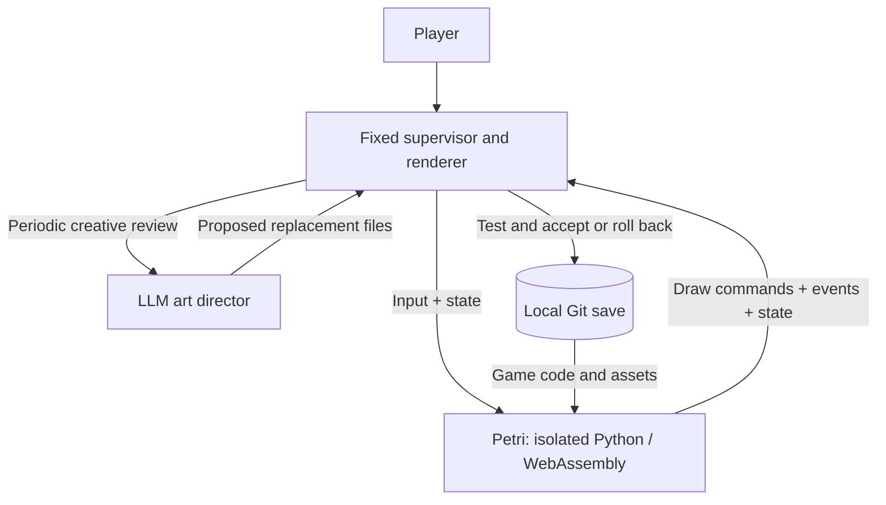

# Throngogenesis — setup and containment guide

## How it works



The supervisor makes the API calls, checks proposed changes in a fresh sandbox, renders bounded drawing commands and manages the local Git history. Mutable Python is **never executed natively**. The sandbox receives no host filesystem mounts, credentials, or configured network access.

## Inoculate your own colony

Requires 64-bit Python 3.12+ and Git. No Docker or guest OS setup.

### Linux

```bash
git clone https://github.com/nlantz/Throngogenesis.git
cd Throngogenesis
python3 -m venv .venv
source .venv/bin/activate
python -m pip install -r requirements.txt
python -m unittest -v test_containment
python supervisor.py
```

### Windows

```powershell
git clone https://github.com/nlantz/Throngogenesis.git
cd Throngogenesis
python -m venv .venv
.\.venv\Scripts\python -m pip install -r requirements.txt
.\.venv\Scripts\python -m unittest -v test_containment
.\.venv\Scripts\python supervisor.py
```

Click to place food. Escape or close the window to exit. Controls may evolve. Run the containment tests before enabling evolution; if they fail, stop.

### Enable evolution

Use an OpenAI-compatible chat completions API. Keep your API key outside the repository.

Linux (assuming your key is stored in a private file):

```bash
export LIVING_GAME_API_KEY="$(tr -d '[:space:]' < ~/.secrets/OpenAPIKey.txt)"
export LIVING_GAME_MODEL="gpt-5-mini"
python supervisor.py --allow-evolution --interval 30 --max-calls 5
```

Windows:

```powershell
$env:LIVING_GAME_API_KEY = (Get-Content "$HOME\.secrets\OpenAPIKey.txt" -Raw).Trim()
$env:LIVING_GAME_MODEL = "gpt-5-mini"
.\.venv\Scripts\python supervisor.py --allow-evolution --interval 30 --max-calls 5
```

You may configure a different full HTTPS chat completions endpoint using `LIVING_GAME_URL` and a custom raw key header with `LIVING_GAME_KEY_HEADER`.

| Option | Default | Purpose |
|---|---:|---|
| `--interval` | 300 s | Time between creative reviews |
| `--max-calls` | 12 | API calls per session |
| `--max-tokens` | 8192 | Maximum completion tokens |
| `--allow-evolution` | Off | Enable the art director |

A 120-frame smoke test with varied time steps and input is run before accepting changes. Empty rectangles are skipped and finite geometry is bounded and rounded. API calls may temporarily interrupt the game loop. The API output cap is sent as `max_completion_tokens`; the provider must support that parameter. Call and token limits are **not** a hard dollar cap; configure a provider-side budget.

## Your save is a Git branch

Each accepted evolution is committed to a separate, local Git repository at `world-contained/`. Its `evolution` branch contains the game source, world state, artwork definitions and the director's creative journal.

```bash
git -C world-contained log --oneline
```

The supervisor attempts to recover from runtime failures by restoring the previous checkpoint, retaining rejected generations under `refs/petri/rejected/`. Automatic rollback is best effort; older saves may not have a rollback ref.

To manually restore an earlier generation, close the game, optionally create a backup branch, and reset the local save to the desired commit. Do not change branches while the supervisor is running.

```bash
git -C world-contained branch backup-before-restore
git -C world-contained reset --hard COMMIT
```

The local save has no configured remote and is ignored by the outer project repository. Existing legacy `world/` saves are left untouched.

## Containment: Petri

| Capability | Supervisor | Mutable game |
|---|---|---|
| LLM API access | Configured HTTPS endpoint | None |
| Host filesystem | Yes | No mounts |
| API credentials | Yes | Not forwarded |
| Native Python execution | Trusted code only | No |
| Game logic and artwork | Fixed interface | Creative control |

Petri uses Eryx, a CPython interpreter compiled to WebAssembly and executed by Wasmtime. Guest memory is limited to 128 MiB, virtual filesystem space to 4 MiB, and execution time to one second per call. No host callbacks are registered. The LLM may replace only four named files: `main.py`, `world.json`, `assets.json` and `journal.md`.

> [!WARNING]
> Experimental containment, not security-certified software. The Eryx/Wasmtime runtime, bindings, JSON handling and renderer remain trusted dependencies. Guest stdout is size-checked after capture, and independent host CPU, memory and disk quotas are not implemented. Git history grows over time. Use additional OS/VM isolation for adversarial testing or sensitive hosts. HTTPS redirects are refused. There is no native execution fallback.

The initial containment tests and live evolution have been exercised on Linux. Windows runtime testing is still outstanding. The tests are not a comprehensive security audit.
